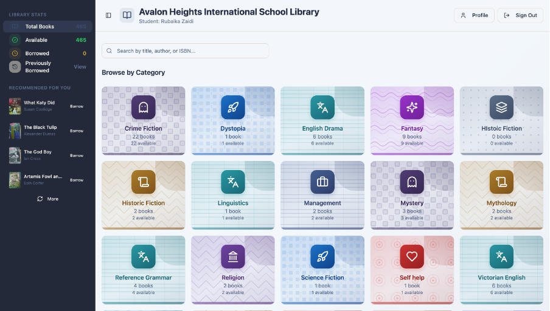
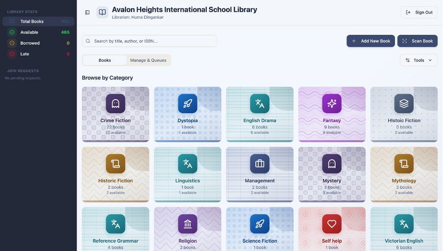
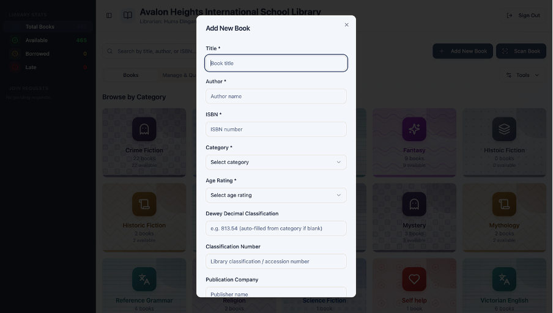
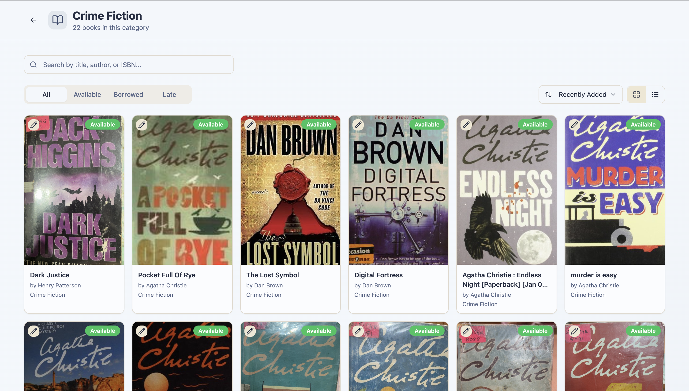

# 📚 AHIS Library Management App

A digital library management system designed to improve book discoverability, simplify borrowing, and streamline library operations at Avalon Heights International School.

## 📖 Overview

When I couldn’t find *Wuthering Heights* in my school library despite three copies being available, I realised that the challenge wasn't necessarily a lack of books, but limited access to information about them.

This inspired me to build a Library Management App that makes the library's collection easier to discover while simplifying administrative tasks for librarians.

Designed with the potential to serve **1,200+ students and library users**, the application brings book discovery, borrowing requests, and library administration into one centralised platform.

## ✨ Features

### 👩‍🎓 Student Features

- **Book Search:** Search the library catalogue and check book availability.
- **Borrowing Requests:** Submit requests to borrow books.
- **Borrowing History:** View previous and current borrowing records.
- **Due-Date Reminders:** Receive reminders about return deadlines.
- **Personalised Recommendations:** Discover books based on previous borrowing activity.

### 📚 Librarian Features

- **Centralised Catalogue:** View and manage book information.
- **Borrowing Management:** Track borrowing records and book circulation.
- **Request Management:** Approve or reject borrowing requests.
- **Fine Management:** Specify fines for overdue returns.
- **Spreadsheet Export:** Export the complete book database for record-keeping and reporting.

### ⚙️ Automated Book Cataloguing

- **QR Code Scanner:** Scan book codes to streamline cataloguing.
- **ISBN Lookup Integration:** Retrieve bibliographic information through external APIs using ISBN numbers.
- **Automatic Data Entry:** Populate database entries with retrieved book details, reducing manual data entry.

## 🛠️ Technical Highlights

- External API integration for ISBN-based book information retrieval.
- Separate workflows for students and librarians.
- Book catalogue search and availability tracking.
- Borrowing request and record management.
- Automated book-detail population.
- Database export for administrative record-keeping.

## 🎯 Project Motivation

This project began with a simple frustration: being unable to locate a book that was already available in the library.

Building the application helped me explore how software can address everyday inefficiencies, improve access to information, and simplify processes for both users and administrators.

Rather than merely digitising an existing catalogue, I wanted to create a more accessible and useful library experience.

## 🚀 Intended Impact

The application is designed to support **1,200+ students and library users** at Avalon Heights International School by making it easier to discover books, manage borrowing, and access library resources.

---

*Built to make discovering, borrowing, and managing books simpler.*
